# Установка Hermes Agent
> [!NOTE]
> Дальнейшие инструкции содержат скриншоты, сделанные в операционной системе Windows, однако содержание конфигурационных экранов и параметров конфигурационных файлов одинаково, как для установки в Windows, так и для установки в MacOS.

## Содержание

- [1. Получение загрузчика для выкачивания и установки программы](#1-получение-загрузчика-для-выкачивания-и-установки-программы)
- [2. Непосредственная загрузка компонентов для Hermes Agent](#2-непосредственная-загрузка-компонентов-для-hermes-agent)
- [3. Первоначальная настройка](#3-первоначальная-настройка)

## 1. Получение загрузчика для выкачивания и установки программы
Загрузчик для установки Hermes Desktop можно получить по адресу https://hermes-agent.nousresearch.com/desktop.
> [!NOTE]
> Доступ из браузера к большинству сайтов, связанных с AI (в том числе, с агентскими системами, скилами и т.д.) закрыт самими разработчиками в связи с санкциями. Тем не менее, обычно такое программное обеспечение является открытым (Open Source), поэтому большинство программ имеет репозиторий на GitHub, к которому есть доступ. Поэтому, технически, после получения первоначального загрузчика, выкачивание и установка Hermes Agent на локальном компьютере не требует каких-либо дополнительных действий.
> Эта ситуация касается и различных дополнений, которые можно устанавливать в агентские системы. Обычно, все они имеют копию на GitHub и основная проблема - найти точный URL для конкретного дополнения.
> [!WARNING]
> Установку Hermes Agent в Wiondows можно проводить от имени обычной учетной записи (права администратора не требуются).
## 2. Непосредственная загрузка компонентов для Hermes Agent
Установка агента можен занимать 10-15 минут, дождитесь окончания процесса.
> [!NOTE]
> В процессе установки будет установлен пакет программирования Python (возможно, в дополнении к уже установленной версии, т.к. Hermes Agent использует конкретную версию, которая может не совпадать с уже установленной версией). Если вы в устнановленных программах увидите Python, не удаляйте его, т.к. в свой работе Hermas Agent активно использует возможности Python для создания временных скриптов, которые помогают в решении различных сценариев.
## 3. Первоначальная настройка
После установки необходимо запустить первоначальную настройку Hermes Agent.
Для этого в MacOS вызовите Terminal, а для Windows щелкните правой кнопкой мыши по меню `Пуск` и выберите (в зависимости от настроек) командную консоль, терминал или сессию Power Shell (права администратора не нужны).
Далее вводим:
```
hermes setup
```
- на первоначальном экране используем опцию `2 (Full Setup)`:
<p align="center">
  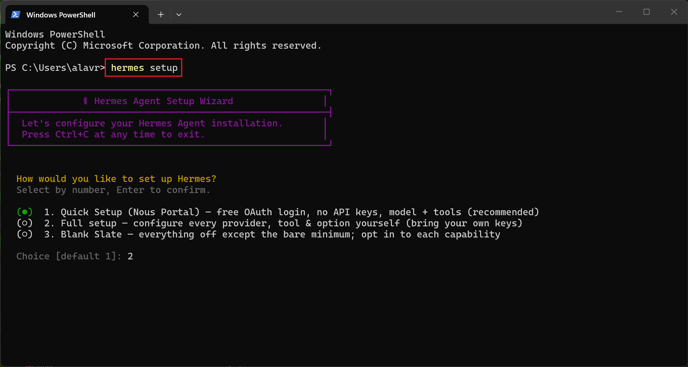
</p> 

- на следюущем экране можно увидеть инфомрацию о корфигурационных файлах, с которыми работает Hermes Agent и которые можно править напрямую для изменения конфигурации агента. Также конфигурацию можно изменять через графический интерфейс или с помощью команды `hermes config edit`:
<p align="center">
  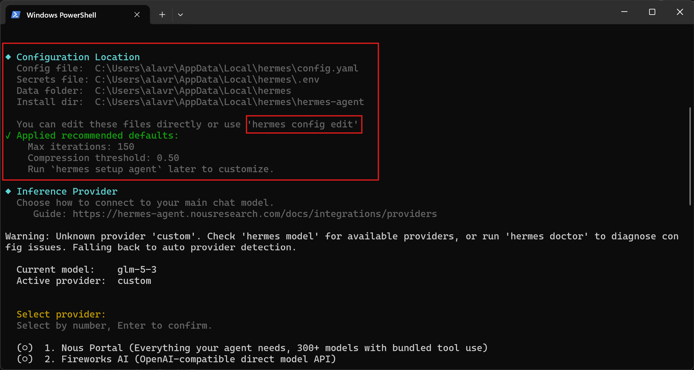
</p> 

- следующий выбор в настройках агента - **Inference Provider**. Вводим `41 Custom endpoint`:
<p align="center">
  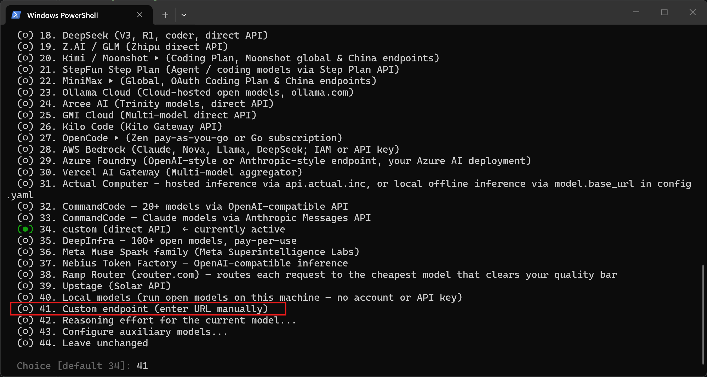
</p> 

- вводим URL и API Key полученные вами для работы с моделями. Будет выполнена доступность данного URL и правильность введенного ключа, и, если что-то неправильно, система перезапросит ввод данных:
<p align="center">
  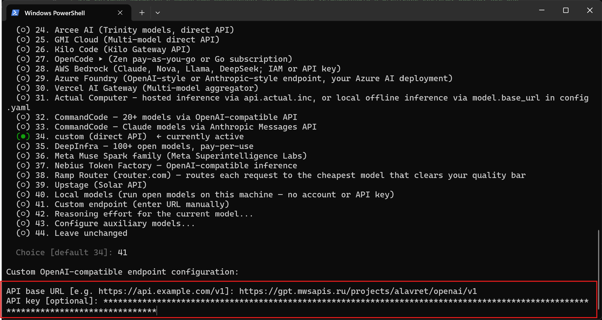
</p>  
<p align="center">
  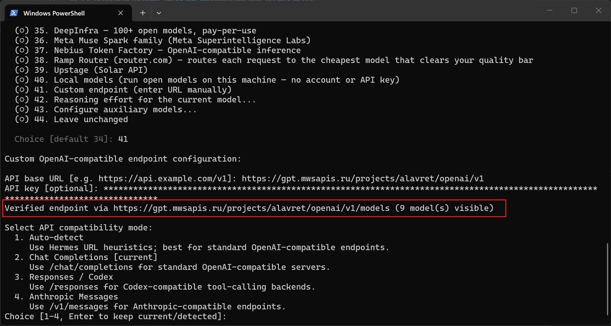
</p> 

- далее необходимо ввести информацию об используемом протоколе для работы с моделями, выбираем `2. Chat Completions`:
<p align="center">
  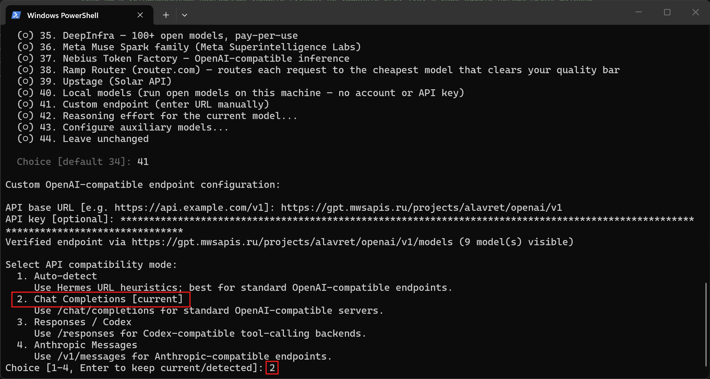
</p> 

- далее выбирается модель, которая будет использоваться по умолчанию, в примере ниже выбрана GLM 5.3:
<p align="center">
  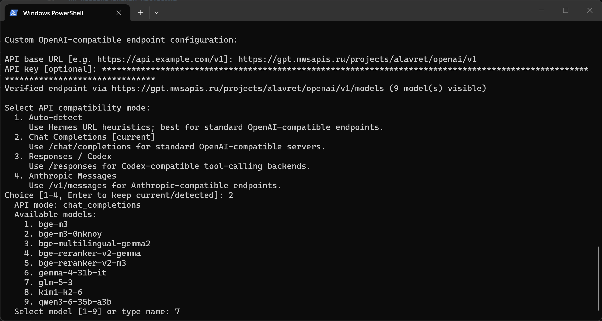
</p> 

- далее необходимо выбрать размер контекстного окна для модели по умолчанию. Можно оставить autodetect, либо выставить значение, указанное для конкретной модели вашего провайдера. Для MWS Model Hub информацию можно посмотреть в табличке [Доступные модели](https://mws.ru/docs/cloud-platform/gpt/general/gpt-models.html). Для размера в 256 тыс. токенов нужно вводить значение `262144`:
<p align="center">
  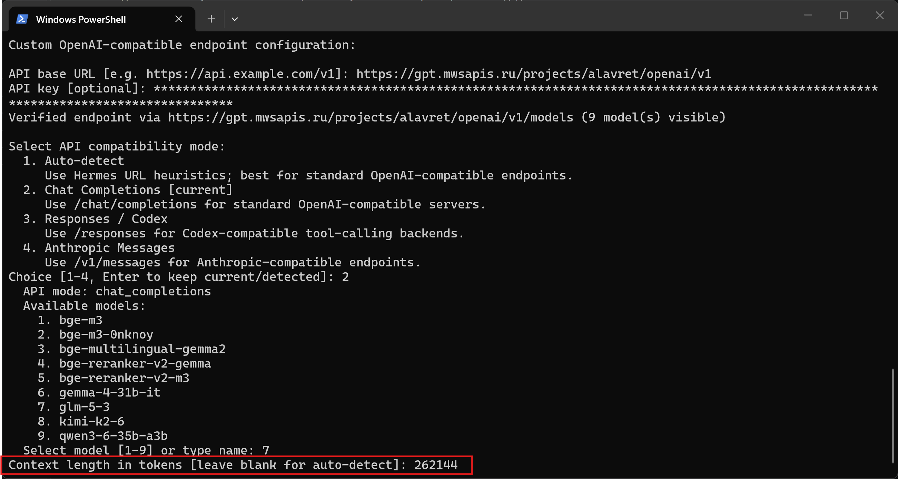
</p> 

- далее запрашивается удобное имя для настраиваемого провайдера, придумайте ее сами:
<p align="center">
  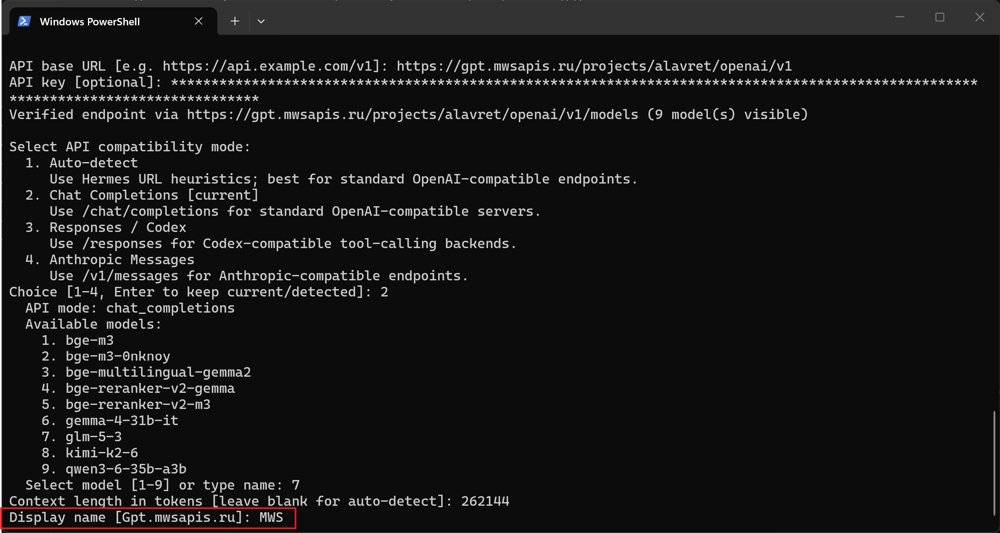
</p> 

> [!NOTE]
> обратите внимание, что установка для Windows сохранила URL провайдера и API Key в разных файлах. URL был сохранен в файле `.env` в каталоге с установкой Hermes Agent, а URL - в файле `config.yaml`

- далее выбираем уровень размышлений для модели по умолчанию.
> [!NOTE]
> Для GLM 5.3 в сервисе MWS Model Hub есть следующие фиксированные значения: `minimal`, `low`, `medium`, `high`.

<p align="center">
  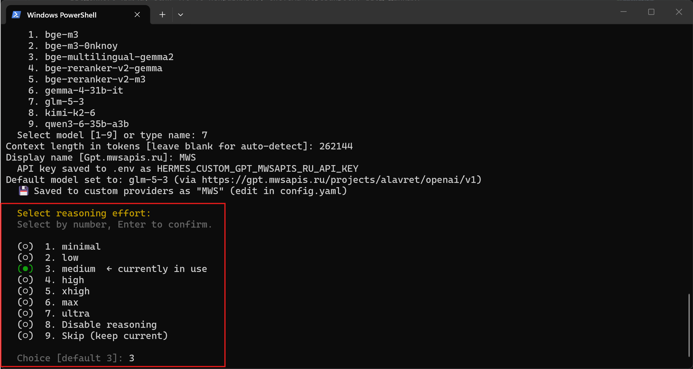
</p> 

- далее запрашивается среда для запуска консольных команд и скриптов Python (влияет на безопасность работы с данными через Hermes Agent). Для некритичных систем можно использовать опцию `local`:
<p align="center">
  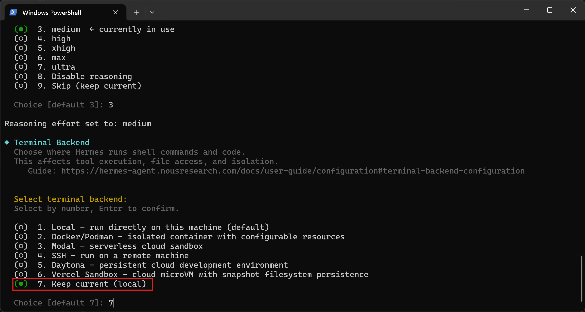
</p> 

- далее можно сконфигурировать подключение к платформам обмена сообщениями. В данном случае, я пропускаю данный пункт (нажимаю `Enter`):
<p align="center">
  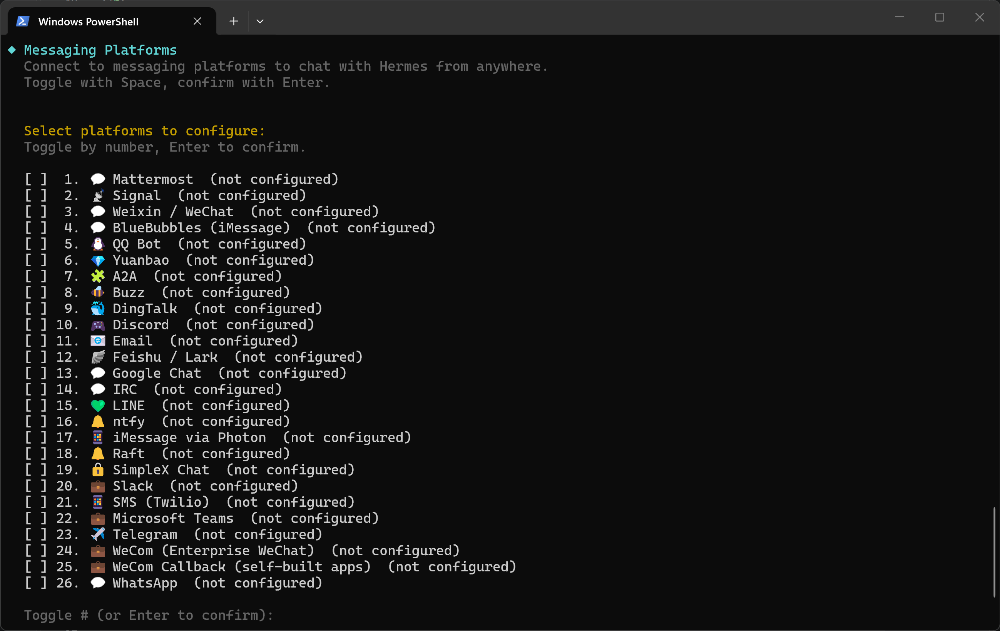
</p> 

- далее предлагается настроить плагины для выполнения различных задач с помощью агента. Значения по умолчнию закрывают базовые сценарии, поэтому можно нажать `Enter`:
<p align="center">
  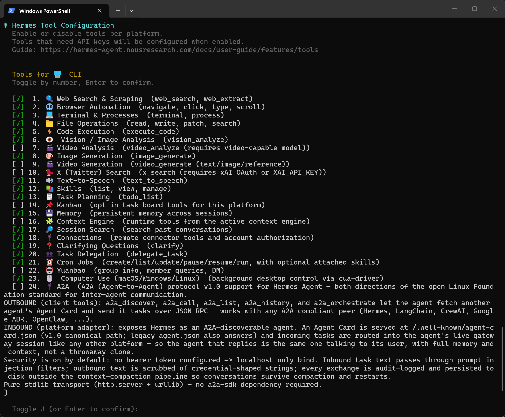
</p> 

- если на предыдущем этапе в списке вспомогательных средств было выбрано **Browser Automation**, то следующий экран предлагает на выбор несколько различных движков для такой автоматизации. На текущий момент целесообразно выбрать пункт `5. Browser Use`:
<p align="center">
  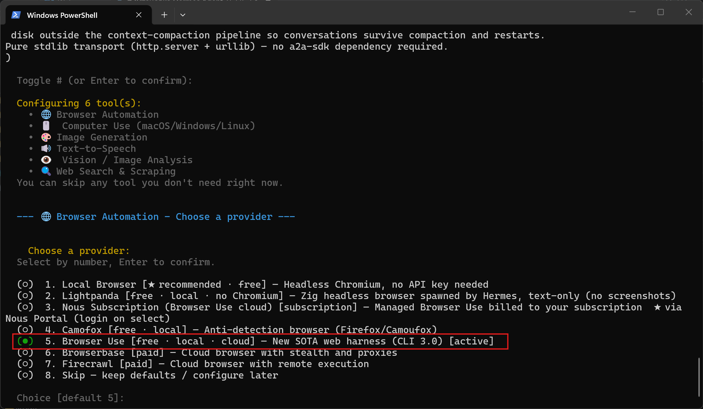
</p> 

- далее предлагается выбрать дополнительно доступ к моделям через встроенного провайдера. Пропускем этот шаг - пункт `10. Skip`:
<p align="center">
  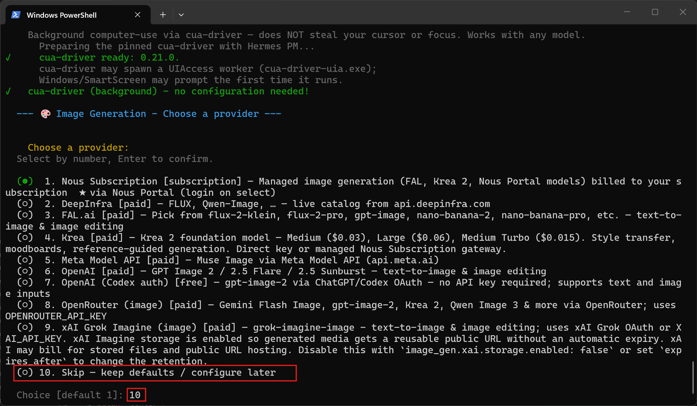
</p> 

- следующий экран предлагает выбрать Text-to-Speech провайдера. Среди бесплатных вариантов можно выбрать как облачный сервис, так и с возможностью локальной инсталляции. В данном случае выбрана облачная инсталляция, пункт `1. Microsoft Edge TTS`:
<p align="center">
  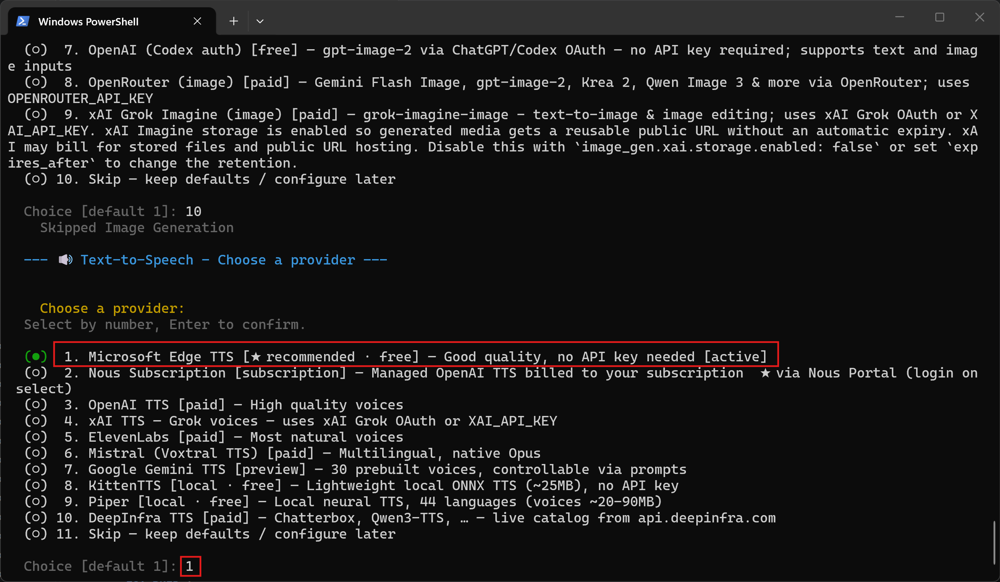
</p> 

- далее предлагается выбрать поставщика поискового индекса для поиска в Интернете.
> [!NOTE]
> Как правило, возможность поиска самой моделью информации в Интернет определятся провайдером, который обеспечивает работу этой модели. И большинство провайдеров такую опцию не предоставляют. Т.е., если просто спросить у модели, какая погода в городе N, то такущая погода не будет выведена, т.к. модель не имеет доступа в Интернет при инференсе. Поэтому при работе с агентами есть несколько опций, которые обеспечивают возможность работы с данными в Интернет - запуск локальных скриптов на Python, симулирующих работу браузера, работу через механизмы автоматизации десктопного браузера или использование сервиса поискового индекса. Такой сервис можно установить локально, либо использовать какого-либо внешнего поставщика.
В данном случае такой сервис не используется (`17. Skip`), но можно попробовать `DuckDuckGo` или какой-то из представленных:
<p align="center">
  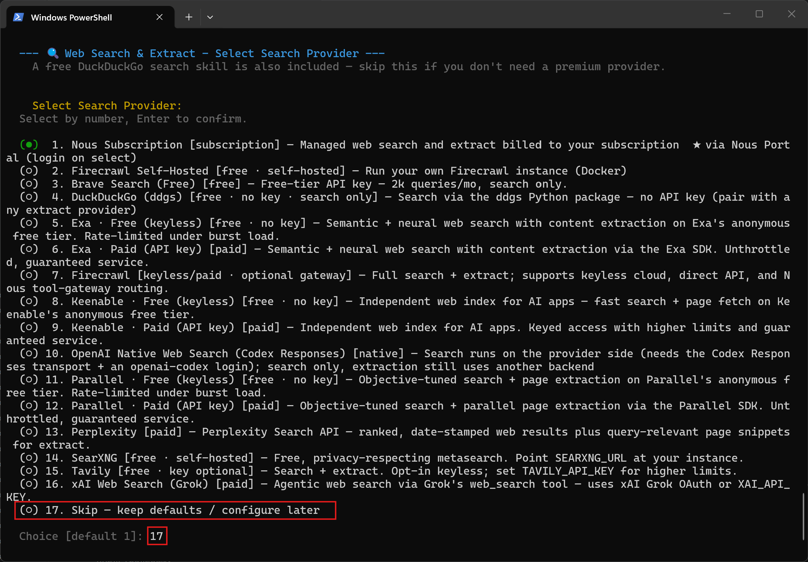
</p> 

- последний экран содержит сводную информацию по файлам конфигурации Hermes Agent, а также по командам его настройки:
<p align="center">
  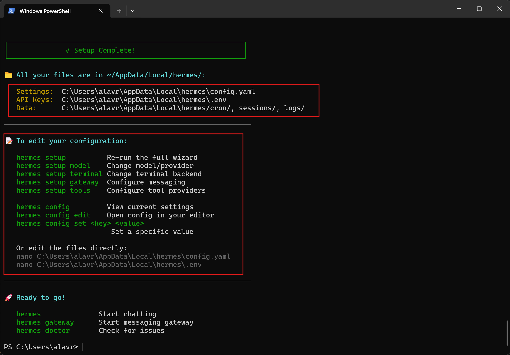
</p> 


