# Настройка Model Hub 

## Содержание
Данное руководство содержит инструкцию по генерации ключа для доступа к GPT Model Hub в сервисе MWS CP. Официальная документация - https://mws.ru/docs/cloud-platform/gpt/general/quickstart-gpt.html

1. [Создание сервисной учётной записи](#создание-сервисной-учётной-записи)
2. [Получение API ключа](#получение-api-ключа)
3. [Активация сервиса и создание Deployment](#активация-сервиса-и-создание-deployment)
4. [Получение URL для работы с Model Hub](#получение-url-для-работы-с-model-hub)
5. [Дальнейшие шаги](#дальнейшие-шаги)

---

## Создание сервисной учётной записи 
Для работы с моделями необходимо иметь API ключ. Технически API ключ позволяет ассоциировать запрос с определенной учётной записью. В облаке MWS такой учётной записью может быть только сущность Service Account (не принадлежащая реальному пользователю учетная запись). 

Поэтому обязательным шагом для начала работы с моделями в облаке MWS является создать сервисную учётную запись.

> [!NOTE]
> Технически вы можете иметь несколько сервисных учётных записей для доступа к сервисам одного проекта (в том числе, Model Hub), и каждой SA выписать несколько API ключей. Но для проекта есть квота по умолчанию на 100 ключей всего от всех SA (можно расширить через техническую поддержку).

1. В [веб-консоли](https://console.mws.ru/) выберите нужный проект.
2. В списке сервисов выберите `IAM` → `Сервисные аккаунты` и нажмите кнопку `Создать`.

  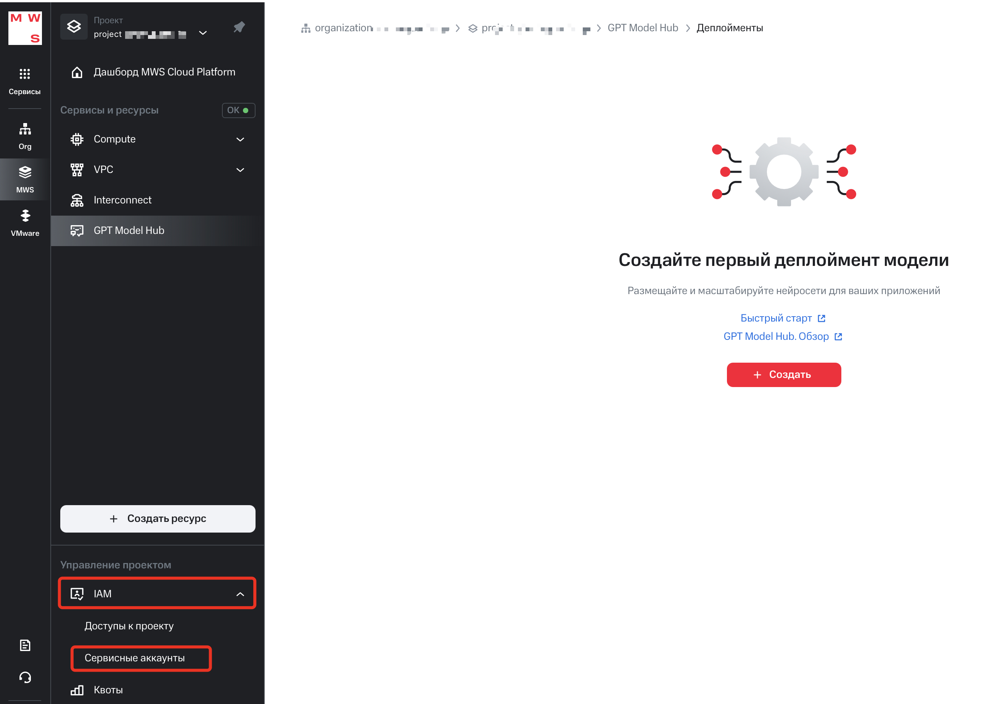

 

  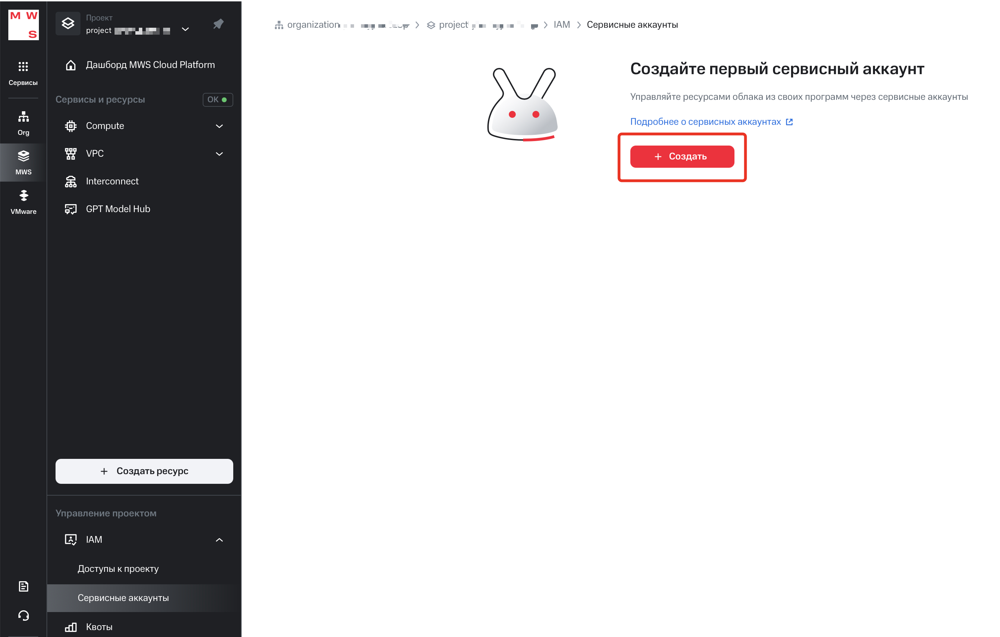

 

3. (опционально) Измените автоматически сгенерированное имя сервисного аккаунта. Позже это имя (name) и созданный из него идентификатор (ID) нельзя изменить, меняется только отображаемое имя (display name) сервисного аккаунта.
4. (опционально) Заполните описание.
5. Назначьте этому сервисному аккаунту роль `gpt.inferencer` для доступа к сервису Model Hub текущего проекта.

  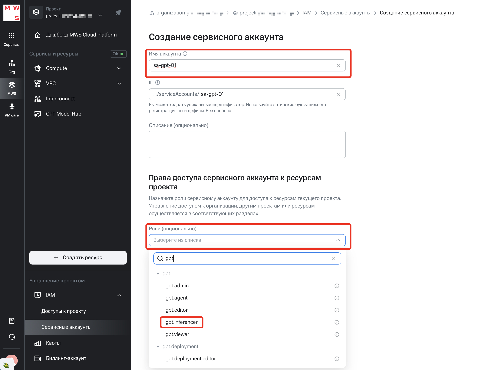

 

6. Нажмите кнопку Создать.

  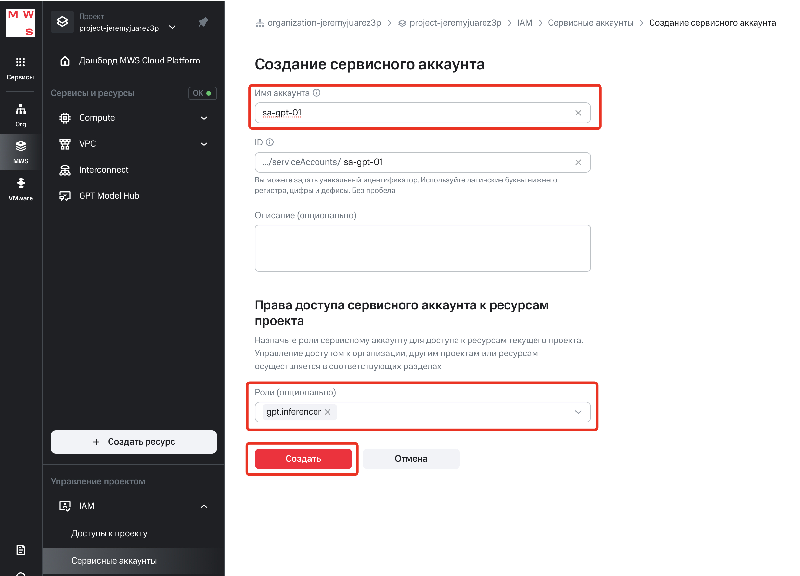

 

---

## Получение API ключа
Далее необходимо выписать для созданной сервисной учётной записи API ключ. Для этого:
1. Выбираем нужную сервисную учётную запись (она должна быть с правами `gpt.inferencer`):

  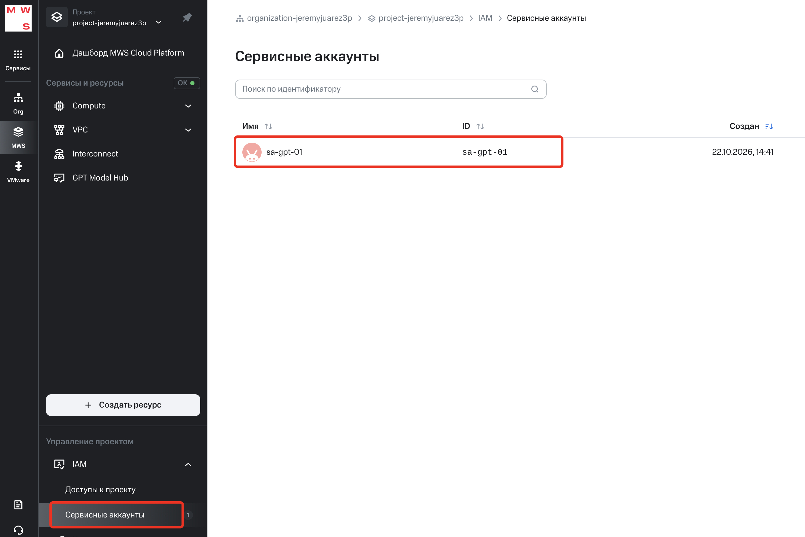

 

2. Переходим в раздел `Ключи доступа` и нажимаем на кнопку "Создать":

  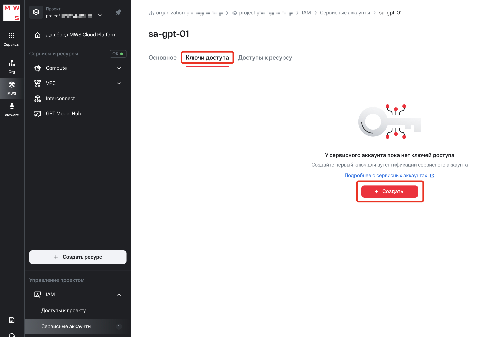

 

3. Нам необходим `API ключ`:

  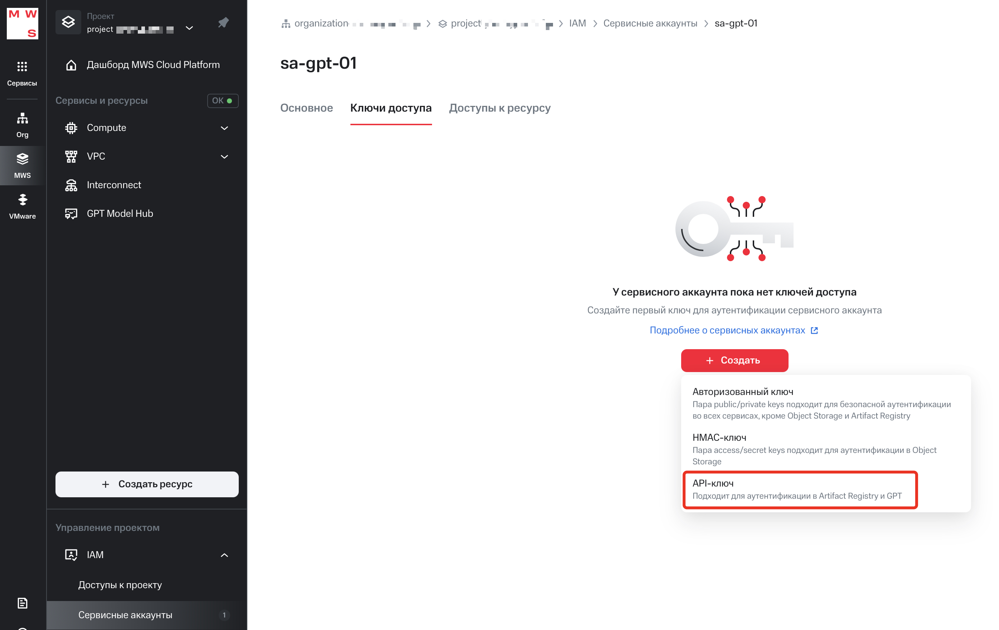

 

4. В следующем окне можно нажать на `Создать` (опционально можно заполнить название ключа).

  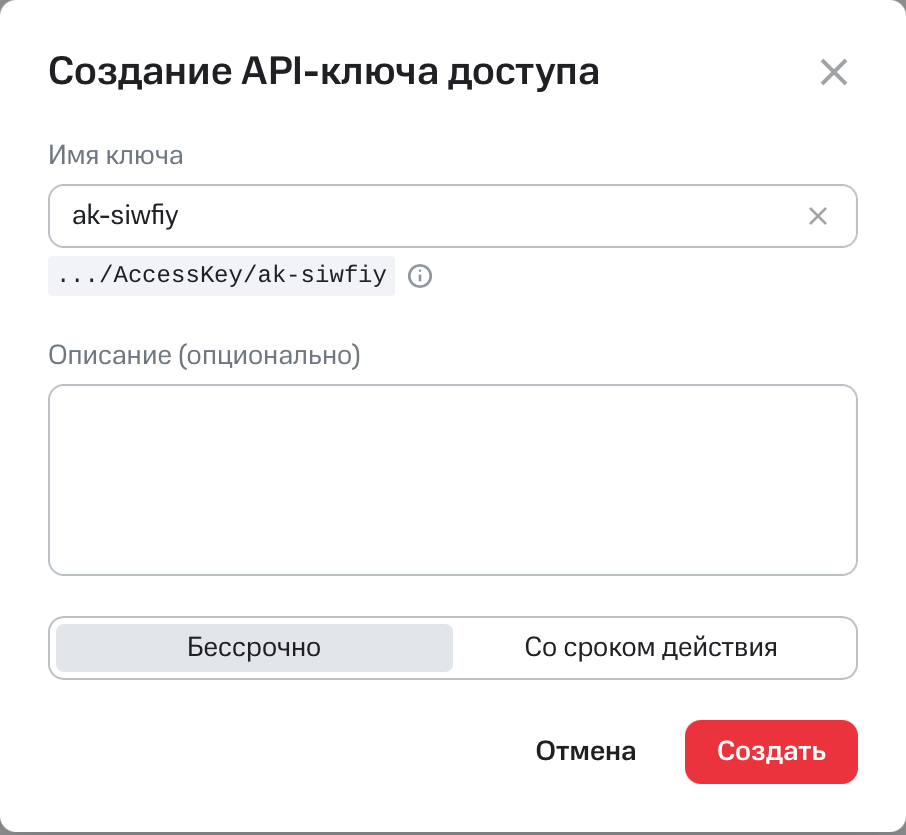

5. Далее появляется окно с содержимым ключа.

  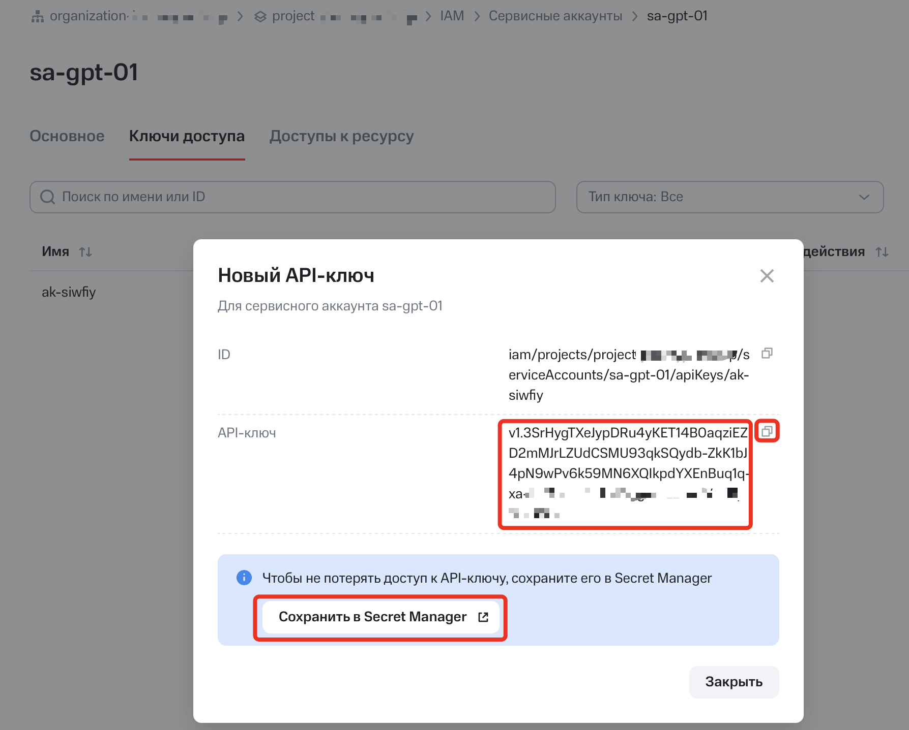

> [!WARNING]
> Содержимое API ключа показывается только один раз. Больше в свойствах сервисной учётной записи этот ключ вы увидеть и скопировать не сможете. Сразу после генерации вы можете сохранить данный ключ в сервисе облака `Secret Manager` (платная опция), либо скопировать данный ключ и безопасно хранить его у себя.

---

## Активация сервиса и создание Deployment
Для работы с сервисом Model Hub в MWS его нужно активировать в проекте и добавить модели (создать деплоймент модели в проекте).
1. В [веб-консоли](https://console.mws.ru/) выберите нужный проект.
2. В списке сервисов выберите GPT Model Hub. При первом запуске нажмите кнопку `Активировать`, это необходимо выполнять от имени пользователя с ролью `admin`.
3. В списке сервисов выберите GPT Model Hub и нажмите кнопку Создать.

  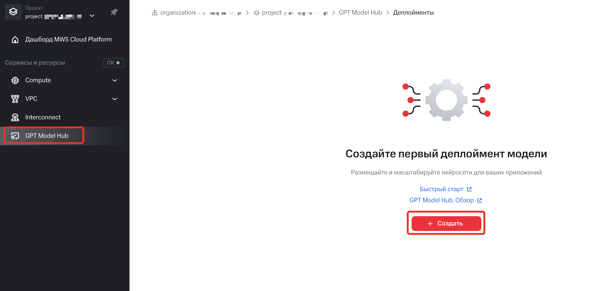

4. По одной выбираем модели, с которыми будем работать.

  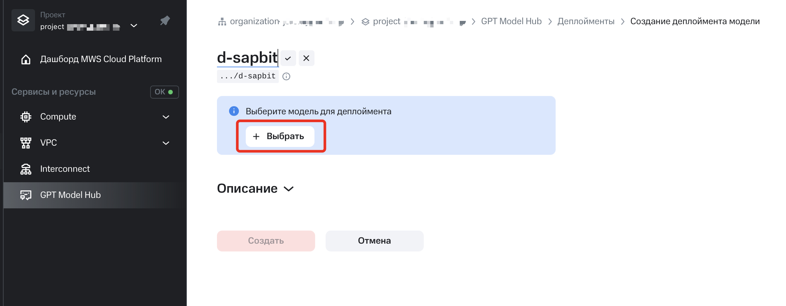

  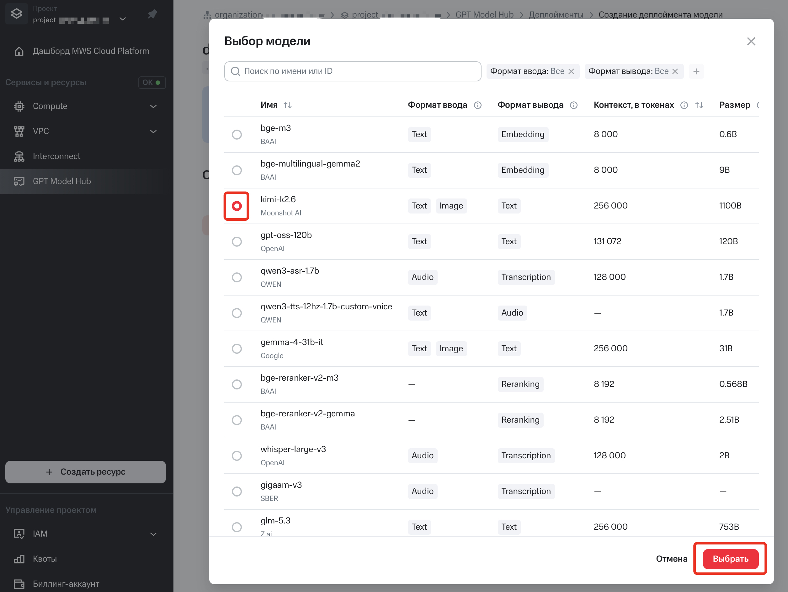

> [!NOTE]
> "Лишние" модели в списке не потребляют каких-либо ресурсов или денег. Вы можете добавить в проект все существующие модели и использовать в ПО именно те, которые вам нужны в данный момент времени.

> [!NOTE]
> Модели могут различаться по типу входных данных (текст, картинка, аудио) и типу выходных данных (текст, картинка, аудио, embeddings/вектора). Программное обеспечение, которое работает с LLM, требует, как правило, моделей с определёнными входными и выходными типами данных. Для чата и агентских задач подходят модели, у которых на вход поступает text или image, и на выходе также есть text. Для RAG систем на выходе должны быть embeddings, для ПО, которое работает с аудио данными, на входе ИЛИ выходе должно присутствовать audio.

> [!TIP]
> На октябрь 2026 года для чата и агентского ПО наиболее актульным будет такой список моделей:
> | Имя модели | Описание |
> | --- | --- |
> | GLM 5.3 | Для тяжёлых агентских задач, аналитики и сложных исследований |
> | Kimi 2.6 | Немного устарела, поэтому простые задачи, но умеет работать с картинками |
> | qwen3.6-35b-a3b | быстрая, простая модель для работы с документами, суммаризацией, поиска в интернете и общими ответами на вопросы различным темам, умеет "читать" картинки |
> | gemma-4-31b-it | аналогично qwen3.6-35b-a3b, была специально обучена на предоставление выверенных, "человеческих" ответов, т.е. с ней приятно общаться. Понимает картинки |

5. Проверить список добавленных моделей (ниже пример скриншота, у вас может быть свой собственный список).

  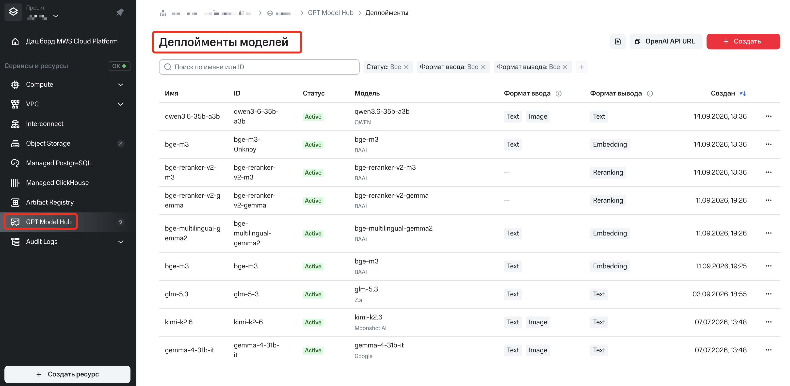

---

## Получение URL для работы с Model Hub
**Наряду с API key, модели также нужен URL**, куда ПО будет подключаться и делать запросы в модель.
Он для каждого проекта в облаке MWS разный.
Получить его можно через эту кнопку в настройках сервиса Model Hub:

  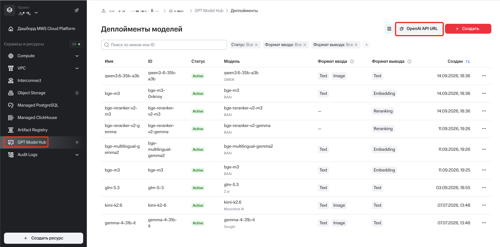

---

## Дальнейшие шаги
Теперь у вас на руках есть URL и API Key и вы можете настраивать ПО на работу с моделями.

[Вернуться в README.md](README.md)
[Начальная настройка Hermes Agent](<Setup Hermes Agent.md>)

