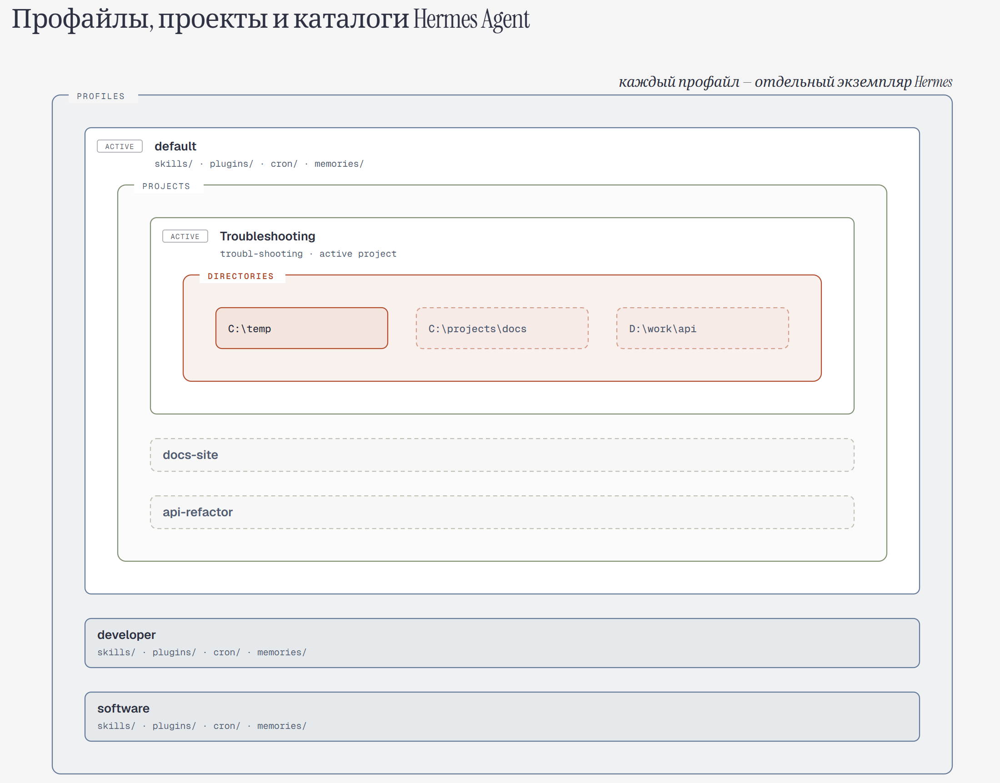

# Запуск и настройка десктопного приложения Hermes Agent
## Настройка списка моделей
Запуститите через иконку приложения десктопный клиент Hermes Agent. В нижнем правом углу рядом с названием модели откройте список и выберите пункт меню `Edit Models`:
<p align="center">
  
</p> 

Используйте окно для настройки моделей, которые будут видны в интерфейсе приложения (возможно скрыть ненужные модели и провайдеров):
<p align="center">
  
</p> 
<p align="center">
  
</p> 

## Иерархия сущностей в Hermes Agent
Общая структура:
```
Профиль (стиль общения и правила для работы LLM, коннекторы и плагины) -> Проект (каталоги с данными и правила для работы с данными в каталогах) -> сессии общения с моделями.
```
<p align="center">
  
</p>

## Установка базовых правил работы агента
Hermes Agent использует файловую систему для хранения инструкций, которые добавляются в запрос пользователя, чтобы контролировать поведение модели.

[Табличка из документации](https://hermes-agent.nousresearch.com/docs/user-guide/features/context-files#supported-context-files)

| Supported Context Files | File |	Purpose	Discovery |
| :--- | :------: | ----: |
|.hermes.md / HERMES.md	| Project instructions (highest priority) |	Walks to git root |
| AGENTS.override.md |	Personal, per-directory override of AGENTS.md (typically gitignored) |	CWD at startup + subdirectories progressively |
| AGENTS.md |	Project instructions, conventions, architecture |	CWD at startup + subdirectories progressively |
| CLAUDE.md	| Claude Code context files (also detected)	| CWD at startup + subdirectories progressively |
| SOUL.md	| Global personality and tone customization for this Hermes instance |	HERMES_HOME/SOUL.md only |
| .cursorrules |	Cursor IDE coding conventions |	CWD only |
| .cursor/rules/*.mdc |	Cursor IDE rule modules |	CWD only |

Ключевыми файлами здесь являются файлы `SOUL.md` и `AGENTS.md`/`HERMES.md`.

`SOUL.md` существует всегда, в нем определяются обязательные инструкции для модели, которые вставляются в начало каждой сесиии. В этом файле прописываются тон общения, персонализация, основные шаблоны для ответов на вопросы пользователя. Для каждого профиля файл SOUL.md может быть свой, изменить его также можно в GUI через эту кнопку:
<p align="center">
  
</p> 
<p align="center">
  
</p> 

Начинать работу можно с файла SOUL.md по умолчанию. Примеры SOUL.md приведены в папке `soul.examples`.

> [!WARNING]
> Не помещайте в SOUL.md пути к файлам/папкам, временные инструкции для проекта, соглашения, которые актуальны только для части ваших запросов.

`AGENTS.md`/`HERMES.md` - это необязательные файлы, которые располагаются в каталоге, с файлами которого вы собираетесь работать через агента Hermes. Как правило, в одном из этих файлов описывается суть проекта, архитектура, принятые соглашения по работе с файлами проекта и т.д. В общем случае это важно для работы с программным кодом, но может быть полезно и для каталогов, где есть много рабочих файлов с фиксированной структурой документов, а также правила их формирования, которые можно описать внутри данных файлов.

## Профили (Profiles)
> [!NOTE]
> Для понимания необходимости использвания профилей нужно учитывать, что в каждом профиле можно задать стиль общения с моделью (через SOUL.md), а также в каждом профиле может существовать свой собственный список Capabilities (всего того, что агент дает модели - информацию о внешнем мире и средства для взаимодействия с другими системами).

В общем случае, профили могут использоваться для переключания между различными режимами работы агента. Например, это может быть агент-исследователь (для проработки какой-либо темы), агент-программист, агент-маркетолог и т.д. 
В каждом профиле определяются целевые средства для эффективного выполнения задачи из определенной области. Иметь одного универсиального агента можно, но здесь начинают влиять текущие ограничения работы с моделями.
> [!WARNING]
> Если в рамках одного профиля определять много коннекторов, MCP подключений, скилов/навыков, tools, то в каждый запрос к модели агент будет вставлять краткое описание каждого из таких capabilities, что будет съедать много входных токенов и в общем случае модель может потеряться в выборе конкретного средства для реализации запроса пользователя. Т.е. будет потрачено больше токенов для уточнения задачи и к конечному результату модель придет за большее количество шагов (выходных токенов).

> [!IMPORTANT]
**Общая рекомендация - давать модели в рамках одного профиля только тот список Capabilitiesв, который нужен для выполнения конкретного сценария** - например, создания портфолио для нового клиента и создания на базе этой информации краткой презентации.

Профили можно создавать следующим образом:
<p align="center">
  
</p> 
<p align="center">
  
</p> 
<p align="center">
  
</p> 

Либо создать новый профиль и переключиться между профилями можно через данные кнопки:
<p align="center">
  
</p>

## Проекты (Projects)
Project в Hermes Agent позволяют создать пространство для хранения данных в виде каталогов, которое будет использоваться разными сессиями, в том числе, при перезгрузках оболочки или запуска подагентов. Технически, запросы в модель можно выдавать и без создания проектов. Но с проектами сценарии работы с моделями могут быть сгруппированы в рамках проекта, который, в свою очередь, предоставит необходимые данные для успешного выполнения запросов.

Создать проект можно следующим образом (учитывайте профиль, в котором создается проект):
<p align="center">
  
</p>
<p align="center">
  
</p>

Соответственно, проекты можно создавать, удалять, переименовывать, добавлять в проекты папки и создавать новые сессии с данными внутри проекта.

## Capabilities
Для каждого профиля можно определить инструменты, которыми будет пользоваться Hermеs Agent для выполнения задачи, поставленной пользователем. В список таких инструментов входят skills, tools, connectors, plugins.
<p align="center">
  
</p>

### Skills (Навыки)
Одно из наиболее используемых средств в современной работе в агентском ПО. Навык - это записанная в файле последовательность шагов для получения конкретного результата. Пример простого файла SKILLS.md с навыком `simple-replay` ([формальные требования к файлу SKILLS.md](https://agentskills.io/skill-creation/quickstart)):
```
---
name: simple-reply
description: Помогает составить краткий и вежливый ответ на сообщение пользователя.
version: 1.0.0
tags:
  - communication
  - writing
---

# Задача
Нужно сгенерировать ответ на сообщение пользователя.

# Как действовать
1.  Проверь, есть ли в сообщении ключевое слово (например, «спасибо», «привет», «давай»). Если таких слов нет — не используй этот навык.
2.  Сформулируй ответ лаконично, без лишних деталей.
3.  В конце добавь вежливую фразу, например: «Если нужно что-то уточнить или добавить — напиши, я с радостью помогу».

# Пример
Если пользователь написал: «Спасибо за помощь, теперь можно я попробую оформить заявку?», навык должен ответить: «Конечно! Если возникнут сложности — пишите, разберусь вместе с вами.»
```
Теперь, если разместить этот файл в соответсвующем месте, агент возьмет строки из полей name и description и вставит их в дополнении к запросу пользователя к модели. Если файлов будет несколько, соответствующие строки из каждого файла будут вставлены в каждый запрос к модели. Модель будет учитывать эту информацию для принятия решения, как ответить на запрос пользователя. Если описание какого либо навыка по мнению модели поможет ответить пользователю, то ответ модели будет содержать запрос в агентское ПО на получение полного текста навыка, по которому модель станет действовать, в том числе, выдавая команды агентскому ПО на выполнение каких-либо действий (выполнить скрипт, команду, использовать tools и т.д).

#### Местонахождение файлов SKILLS.md
Глобальный набор скилов  Hermes Agent находится в `~/.hermes/skills/` (в macOS и Linux) или `%HERMES_HOME%\skills\` (в Windows).
Для каждого профиля есть своя собственная папка skills.
Также агент ищет каталоги `.hermes/skills/` и `.agents/skills/` в корневых каталогах, которые включены в проект, из которого запускается сессия к модели. Однако найденные в таком местоположении навыки автоматически не запускаются, т.к. каталог может быть скачан из внешенго источника. В этом случае Hermes Agent спрашивает, доверять ли этому источнику для загрузки навыков.
Дополнительно, навыки могут быть загружены из внешних каталогов, которые были сконфигурированы для данного ПО в config.yaml.

#### Использование навыков
Технически имя навыка можно не указывать, в этом случае есть вероятность, что модель автоматически выберет нужный и тех, что уже установлены в системе. Однако для полного контроля нужно указывать, какой именно навык нужно использовать в данной сессии к модели. В этом случае навык указывается через системную команду к Hermes Agent - `/<skill_name> <user_input>`. 
<p align="center">
  
</p>
#### Поиск и загрузка навыков
На текущий момент существует тысячи навыков для агентов. Самый простой способ их установки - использовать встроенные средства агентского ПО. Для Hermes Agent соответствующее окно вызывается следующим образом:
<p align="center">
  
</p>
Поиск навыков:
<p align="center">
  
</p>
Как только нужный навык будет найден, его можно установить в агента:
<p align="center">
  
</p>

С другой стороны, очень много интересных навыков можно увидеть у коллег, в чатах, в интернете. Попробовать их просто - нужно сохранить каталог (не только файл SKILLS.md), который описывает навык, на свой компьютер в соответствующем месте (см. Местонахождение файлов SKILLS.md).

Например, в данном руководстве есть каталог с несколькими навыками. Т.к. файлы находятся на сервисе GitHub, скачать можно несколькими разными способами. 

Классический - использовать команду `git clone https://github.com/alavret/LLM_Guides.git` для скачивания всех файлов репозитория на свой компьютер и после нужных каталогов с навыками в местоположение для Hermes Agent.

Другой вариант - удостовериться, что браузер открыт на основной страничке с репозиторием (https://github.com/alavret/LLM_Guides.git), нажать на зеленую кнопку и выбрать `Download ZIP`. Это скачает содержимое всего репозитория на компьютер в виде архивного файла, из которого уже можно извлечь нужные навыки и скопировать себе в целевой каталог.
<p align="center">
  
</p>

#### Самостоятельное создание навыка
Если вы постоянно выполняете одну и ту же последовательность действий, например, поискать в интернете информацию, сохранить данные в файл, создать краткую сводку, то можно оформить эти действия в навык - Hermes Agent сам создаст необходимое описание и сохранит его в файл. Для этого используется команда `/learn` ([Документация](https://hermes-agent.nousresearch.com/docs/user-guide/features/skills#learning-a-skill-from-sources-learn)). Примеры такой команды:
```
# A local SDK or doc directory — read with read_file / search_files
/learn the REST client in ~/projects/acme-sdk, focus on auth + pagination

# An online doc page — fetched with web_extract
/learn https://docs.example.com/api/quickstart

# The workflow you just walked the agent through in this conversation
/learn how I just deployed the staging server

# Pasted notes / a described procedure
/learn filing an expense: open the portal, New > Expense, attach the receipt, submit

# A whole book, paper stack, or large docs corpus — becomes a knowledge-base skill
/learn ~/books/designing-data-intensive-applications.pdf
```

